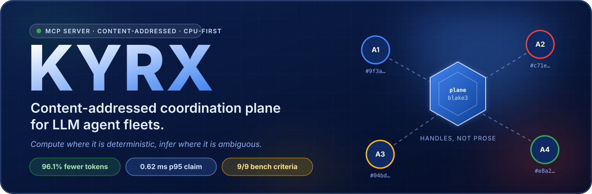
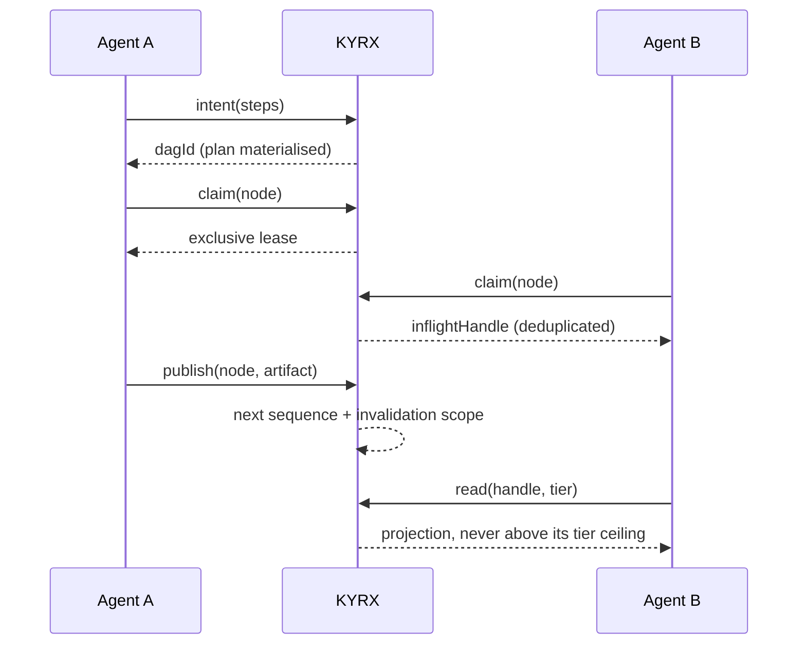

<div align="center">



<br/>

<a href="LICENSE"></a>      

<br/>

**[Why](#why)** · **[How it works](#how-it-works)** · **[The surface](#the-surface)** · **[Guarantees](#guarantees)** · **[Security](#security)** · **[Install](#install)** · **[Integrate](#integrate)**

</div>

> **Part of the [MLKBLK-IT ecosystem](https://github.com/MlkBlk-IT)** — local-first AI infrastructure,
> CPU-only, documented honestly.
>
> **Stack:** [IcyLoom](https://github.com/MlkBlk-IT/icy-loom) (MCP tool gateway) ·
> [Osiris](https://github.com/MlkBlk-IT/osiris) (context engine) ·
> [KYRX](https://github.com/MlkBlk-IT/kyrx) (agent-fleet coordination) ·
> [IcyCache](https://github.com/MlkBlk-IT/icycache) (LLM gateway + cache) ·
> [Loom](https://github.com/MlkBlk-IT/mcp-loom-mcp) (portable context server)


<br/>

**KYRX** is an MCP server that lets a fleet of LLM sub-agents work on a shared plan **without ever passing full context between them**. Agents exchange **handles** (content addresses), not prose. State is computed by **deterministic reducers**, and a language model is called only on the steps explicitly flagged as ambiguous.

> Compute where it is deterministic, infer where it is ambiguous.

| 🔗 Handles, not prose | 🧮 Deterministic first | 🔒 Fails closed |
|---|---|---|
| Artifacts are named by `blake3(content)`. No full context ever crosses an agent boundary — only handles, diffs and projections. | Reducers compute the state. The model is called only on ambiguous steps: **6 calls** for a 40-step reference plan. | Bearer-only HTTP, per-actor rate limits, hash-chained audit trail, fuel-metered WASM sandbox. |

## Quickstart

```bash
git clone https://github.com/MlkBlk-IT/kyrx.git && cd kyrx
python3 -m venv .venv && source .venv/bin/activate   # .venv\Scripts\activate on Windows
pip install -e ".[dev]"
kyrx bench            # reproduce the 9/9 acceptance report
kyrx init --list      # supported MCP clients, then: kyrx init <client>
```

Details, per-client setup and honest limits: [Integrate](#integrate).

## Status

`0.3.0` — the coordination engine is implemented and measured. The reference
bench passes **9 criteria out of 9**, the test suite is green (**182 tests**),
and the type checker is strict (`mypy --strict`, `Any` banned outside a single
documented FFI boundary).

| Criterion | Measured | Threshold |
|---|---|---|
| Spawn payload | **178 tokens** | ≤ 500 |
| State verification (tier 1) | **226 tokens** | ≤ 300 |
| Concurrent deduplication | **100 %** | ≥ 95 % |
| Model calls (40 steps, 6 ambiguous) | **6** | ≤ 8 |
| Replay | byte-for-byte identical | identical |
| p95 claim latency | **0,62 ms** | < 15 ms |
| p95 projection latency | **0,22 ms** | < 25 ms |
| Tier ceilings respected | **0 violation** | 0 |
| Token saving against a naive fleet | **96,1 %** | ≥ 85 % |

Reproduce them with `kyrx bench`.

## Why

Today's agent fleets exchange whole contexts in natural language. Every handoff
re-pays the token cost of the full history, and every agent re-derives its own
version of the truth from prose. KYRX replaces the prose with three primitives:

| Primitive | What it removes |
|---|---|
| **Content-addressed artifacts** | Re-serialising the same payload under different names |
| **A shared, versioned blackboard** | Every agent keeping a private, drifting copy of the state |
| **A native plan with exclusive leases** | Two agents doing the same work, or one agent doing it twice |

## How it works

1. The agent calls `intent(...)` with the **steps** of the plan: what each step
   produces and what it consumes. KYRX derives the graph itself — no graph
   vocabulary crosses the boundary. When the agent declares no step, the model
   proposes them, still in that native shape.
2. The agent calls `manifest(dagId, branch)` and receives a compact list of
   nodes — a handle-scale description of the plan, not a transcript.
3. It calls `claim(nodeId, agentId)`. KYRX grants an **exclusive lease**, or
   returns the `inflightHandle` of a result already in flight when another
   agent got there first. Silent, fast, and the only deduplication mechanism.
4. The agent does the work **outside** the server and calls `publish(...)`.
   KYRX writes the blob, assigns the next sequence number, and computes the
   **invalidation scope** of the write.
5. The agent reads state with `read(handle, tier)` or `project(dagId, tier)` —
   four tiers, from key names only up to full artifacts. A projection never
   exceeds the ceiling of its tier: when the state does not fit, it is
   truncated and the handle of the complete state comes back instead.
6. If a step is `ambiguous`, the **ambiguity router** calls the small model and
   returns the hint **as a handle**. The hint never enters a context window as
   prose.




## The surface

| Tool | Signature | Effect |
|---|---|---|
| `intent` | `(intent, budgetTokens, steps?)` | Materialise a plan. The only model-facing entry point. |
| `manifest` | `(dagId, branch)` | Compact manifest of a branch. |
| `claim` | `(nodeId, agentId)` | Exclusive lease, or the handle of the result in flight. |
| `beat` | `(leaseId)` | Extend a running lease. |
| `publish` | `(nodeId, artifactRef, summary)` | Write a result as a new version. |
| `read` | `(handle \| entryRef, tier, fields?)` | Read at the requested tier. |
| `prove` | `(key)` | Scoped evidence that a key holds nothing. |
| `project` | `(dagId, tier)` | State projection, streamed. |
| `fail` | `(leaseId, reason)` | Release a node for stealing. |
| `trace` | `(dagId)` | The replayable journal. |

Two resources are exposed as well: `kyrx://economy` (the measured token
economy) and `kyrx://plans` (the materialised plans).

## Guarantees

| # | Guarantee |
|---|---|
| I1 | No full context ever crosses an agent boundary — only handles, diffs and projections |
| I2 | Artifacts are immutable and named by `blake3(content)`; entries advance by new version |
| I3 | Writes require an exclusive lease; reads never block |
| I4 | Every cache entry carries an explicit invalidation scope expressed in DAG edges |
| I5 | A `deterministic` step triggers zero model calls |
| I6 | A step over budget degrades its projection tier; it never exceeds the budget |
| I7 | Every projection is byte-for-byte reconstructible from the entry journal |
| I8 | The execution sandbox has no network egress outside its host functions |
| I9 | Every key carries a monotone sequence; concurrent writes are ordered by sequence, never by wall clock |
| I10 | An `ambiguous` flag always carries a score and a textual reason |

## Security

The plane fails closed.

- The **HTTP transport refuses to start without a bearer token**
  (`KYRX_AUTH_MODE=token`). Tokens are compared in constant time and their
  audience is checked against the resource server URL.
- Every call is **rate limited** per actor and per tool (except in
  [solo mode](#coordination-mode)).
- Every call is recorded in a **hash-chained audit trail**: each record
  carries the hash of the previous one, so an altered record breaks the chain.
  In [solo mode](#coordination-mode) the trail is kept in memory only.
- Every input is **bounded**: intent, summary, step names, step count, key
  length, artifact size.
- The sandbox runs WebAssembly with **fuel metering**, a memory limit, a hard
  30 s deadline, and host functions as the only capability: a module that
  imports anything else fails to instantiate.

## Install

```bash
python3 -m venv .venv
source .venv/bin/activate     # .venv\Scripts\activate on Windows
pip install -e ".[dev]"
```

Requires Python **3.11+** (`requires-python = ">=3.11"`). The suite is run on
Python 3.14.7; other versions are declared, not yet verified here.

## Integrate

`kyrx init <client>` writes the KYRX block into an MCP client's configuration.
It merges, never overwrites other servers, writes atomically, takes a
timestamped `.bak` backup before any change, and does nothing when the file is
already up to date.

```bash
kyrx init --list                                   # clients and config locations
kyrx init cursor --print --path out.json           # preview, write nothing
kyrx init cursor --command C:\path\to\.venv\Scripts\kyrx.exe   # stdio
kyrx token                                         # bearer token for HTTP
kyrx init cursor --transport http --token <token>  # HTTP
```

Supported: `claude-desktop` (stdio only), `cursor`, `vscode`, `cline`, `zed`
(`--path` required on Windows), `claude-code`. Per-client blocks, HTTP setup
and limits: [docs/integration.md](docs/integration.md).

> **Honest limits.** `kyrx init` only edits local config files, so it does not
> cover ChatGPT or Gemini. As of 2026-11-15, third-party sources (not OpenAI's
> docs, not re-verified here) say ChatGPT can reach *remote* MCP servers through
> its developer mode (beta): that needs a public HTTPS endpoint, and those
> sources list OAuth or no authentication, not a static bearer token. KYRX's
> HTTP transport is bearer-only and untested with ChatGPT. Gemini: not checked.

## CLI

```bash
kyrx version                    # package version
kyrx info                       # resolved configuration and capabilities
kyrx stats                      # the measured token and time economy
kyrx bench                      # the comparative acceptance report
kyrx serve --transport stdio    # MCP server on stdio (local agents)
kyrx serve --transport http     # MCP server on streamable HTTP (remote agents)
kyrx init <client>              # write the KYRX block into a client's MCP config
kyrx token                      # generate a bearer token for the HTTP transport
```

## Configuration

Every setting is read from the environment with the `KYRX_` prefix, or from a
`.env` file next to the project.

| Variable | Default | Meaning |
|---|---|---|
| `KYRX_DATA_DIR` | `var` | Journal, blobs, audit trail, economy ledger |
| `KYRX_TRANSPORT` | `stdio` | `stdio` or `http` |
| `KYRX_HOST` / `KYRX_PORT` | `127.0.0.1` / `8765` | HTTP listener |
| `KYRX_AUTH_MODE` | `none` | `none` or `token`; `http` requires `token` |
| `KYRX_AUTH_TOKEN` | — | Bearer token, compared in constant time |
| `KYRX_RATE_LIMIT_CALLS` | `120` | Calls per window, per actor and per tool |
| `KYRX_RATE_LIMIT_WINDOW_S` | `60` | Window length |
| `KYRX_MODE` | `auto` | `auto`, `solo` or `fleet`, see [Coordination mode](#coordination-mode) |
| `KYRX_LLM_BASE_URL` / `KYRX_LLM_MODEL` | — | Small model used by the ambiguity router |
| `KYRX_SANDBOX_TIMEOUT_S` | `30` | Hard deadline for sandboxed execution |

## Coordination mode

KYRX adapts its protections to the number of agents using it. `KYRX_MODE` sets
the policy:

| Mode | Behaviour |
|---|---|
| `auto` (default) | Starts **solo** over stdio and **fleet** over http. Switches to fleet, for good, the first time a second agent id claims a node. |
| `solo` | Single-agent fast path. Never switches. |
| `fleet` | Every protection on, from the first call. |

The older `KYRX_SOLO_MODE=true` still means `solo`.

**Solo** drops what only makes sense when several actors must be arbitrated:

- **No rate limiter.** The default limiter refuses the 121st call of a tool for
  one actor within 60 s; a single agent polling `project` or `read` on the same
  key can hit that.
- **Audit trail in memory.** No `audit.ndjson`, no thread hop per call.
  Measured on `Engine.guard()` (one run, N=100, Windows, Python 3.14):
  473.5 µs to 7.3 µs per call.

**Fleet** keeps the rate limiter and writes the hash-chained audit trail to disk.

**How `auto` decides.** Only `claim` carries a real agent identity (`agentId`);
every other tool sees a node, a plan or a key, which says nothing about who
calls. The first `agentId` keeps the plane solo, a second distinct one switches
it. The switch writes the history held in memory to `audit.ndjson` (the chain
stays unbroken), records a `solo->fleet` event in it, then turns the rate
limiter on. It never goes back until the process restarts.

Limits of the detection:

- `agentId` is declared by the caller. Two agents sharing one id are not told
  apart; one agent that changes its id only triggers the safe direction (fleet).
- An agent that only reads and never claims is invisible to the detector.
- Over http, `auto` starts as fleet: a lone visitor cannot be proven.
- The call that reveals the second agent is not counted by the rate limiter.

What no mode changes: leases are enforced (`publish` needs a prior `claim`, and
a lease expires after `KYRX_LEASE_RUN_TTL_S`, 20 s by default, without a
`beat`), the ten tools stay exposed, and the journal and blobs are written to
disk. Measured, the lease manager costs about 22 µs per node against 640-900 µs
for a full claim + publish, so it is not worth bypassing.

Trade-off of staying solo (a lone agent over stdio, or `KYRX_MODE=solo`): the
audit chain is not written to disk, is lost on restart and grows in memory with
every call. The "who did what" guarantee under [Security](#security) starts
once the plane is in fleet.

## Development

```bash
ruff check .                    # lint
mypy                            # strict type check
pytest                          # unit, property, adversarial and chaos suites
kyrx bench                      # reference bench, comparative report
```

## Architecture

```
src/kyrx/
  store/    content-addressed blobs + GC
  board/    keys, versioned entries, append-only journal, sequences
  plan/     native planner, DAG validation, ambiguity flagging
  lease/    lease state machine, node stealing
  reduce/   pure reducers, projection tiers 0..3
  cache/    positive/negative cache, scoped invalidation
  route/    ambiguity router
  trace/    replay journal, metrics
  sandbox/  WASM isolate with fuel and memory limits
  security/ authentication, rate limit, audit chain, input limits
  economy/  token ledger
  mcp/      tool surface, schema validation, resources
bench/      reference scenario, naive baseline, comparative report
tests/      unit, property, adversarial and chaos suites
```

## License

MIT. See [LICENSE](LICENSE).

---

<div align="center">

<sub>Built by <a href="https://github.com/MlkBlk-IT">Malik Belkacemi · MLKBLK-IT</a> · MIT License · © 2026</sub>

</div>
